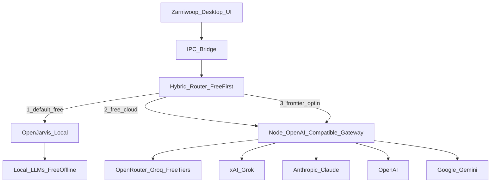

# Zarniwoop — Architecture

## System overview

### Main process hybrid router

Evaluates task intent, privacy level, latency need, and battery/thermal status (`powerMonitor`), then routes:

1. **Local (OpenJarvis)** — default free path when capable  
2. **Free cloud** — OpenRouter free routes / Groq / Google AI Studio free tier  
3. **Frontier cloud** — user-selected or escalated BYOK providers  

### Local engine (OpenJarvis / Ollama)

- Hardware auto-probing (RAM / VRAM / GPU) from Electron main  
- Local LLMs via **HTTP** to Ollama and/or OpenJarvis OpenAI-compatible serve (not a bundled Python process)  
- SQLite vector & FTS5 index  
- MCP tool connectors  

### Cloud gateway (Node, OpenAI-compatible)

- Unified chat/completions-shaped API across vendors  
- BYOK via `safeStorage`  
- Retries, streaming, cross-provider failover  
- Not a bundled Python LiteLLM sidecar  

---

## Feature specifications

### 1. Dual-pane UI & docked companion

- **Default companion mode:** Browser collapsed; AI chat + tools fill a strip **docked to the right**.  
- **Main browser pane (optional):** Electron `WebContentsView` when user expands (“Show Browser”); Chromium extension compatibility target.  
- **Sidebar AI pane:** Default visible in companion mode; collapsible to an icon rail; streams tokens.  
- **Docked OS mode:** Windows `SHAppBarMessage` AppBar reserves work area so other windows **maximize / fullscreen / snap** beside the strip (PC primary). Free (restored) windows may still be dragged under the strip — same as dragging off-screen; that is allowed. macOS uses always-on-top overlay only — the OS does not expose work-area reservation to third-party apps. Shared shell on both platforms. Already-maximized apps may need one restore+maximize to pick up a newly reserved work area.

### 2. Hybrid AI router & power management

- **Local:** notes/tasks, vector indexing, private DOM extraction, offline workflows.  
- **Free cloud:** general chat when local is insufficient and free keys/routes exist.  
- **Frontier cloud:** multi-step CDP automation, deep research, live search when selected or required.  
- **Energy:** on battery or high heat, pause background indexing and throttle local batch size.

### 3. Cloud API gateway & model agnosticism

- All cloud calls normalized to an OpenAI-compatible request shape.  
- Catalog spans free tiers and frontier vendors (see [04_decisions.md](04_decisions.md)).  
- Failover across configured providers on rate limits or downtime (respect free-first unless user pinned a model).

### 4. Local intelligence & memory (OpenJarvis)

- Startup probe configures quantized local models (e.g. Qwen 2.5 3B/7B class).  
- Indexes Markdown notes, tasks, saved tab history on-device only.  
- MCP handlers for desktop files and tools.

### 5. Cross-context intelligence & CDP automation

- DOM inspect → structured prompt-safe JSON; strip injection threats.  
- Form fill and navigation via CDP.

---

## Security & privacy

1. **Context isolation:** `contextIsolation: true`, `nodeIntegration: false`, `sandbox: true` on WebViews.  
2. **Key storage:** provider API keys in OS keychain via Electron `safeStorage`.  
3. **Data bounds:** sensitive notes, autofill, and personal documents never leave the device; process via OpenJarvis only.
